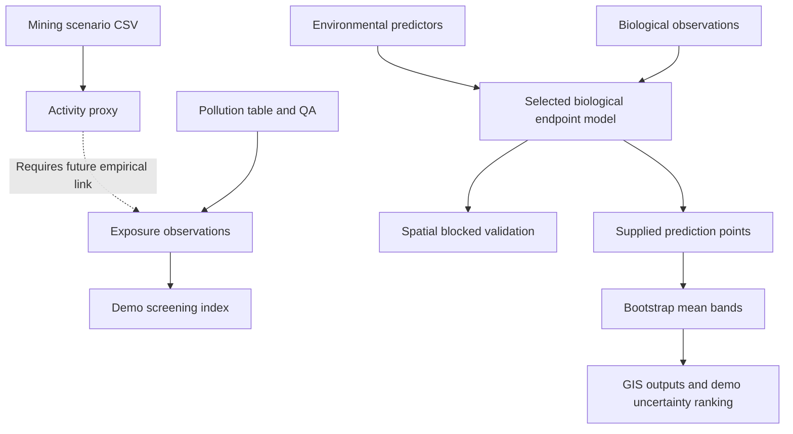

# PEMMSS-ID: Indonesian Coastal Ecological Risk Model

**Research prototype · proof-of-concept · synthetic demonstration data ·
not validated for operational use**

A transparent early-stage research portfolio for a biology/marine ecology researcher
studying coastal pollution, biodiversity, spatial modelling and nickel-mining impacts
in Indonesia. The research question is: **How can environmental contamination,
biological responses and spatial environmental variables be integrated to predict
coastal ecological risk?** This repository tests software interfaces; it does not
answer that question with Indonesian field evidence.

PEMMSS contributes the scenario-based mining-development concept. PEMMSS-ID adds
pollution-data quality control, environmental/biological interfaces and a small
spatial modelling demonstration. **Original PEMMSS does not thereby become a pollution
or ecological-risk model. No upstream PEMMSS implementation is bundled.**

## Current implementation



The dashed link is **not implemented**. Concentrations are available to the joined
research table, but default predictions use only distance and salinity, available
at all prediction fixtures. No pollutant effect is inferred. Hazard, uptake,
causal effects, formal risk, transport and calibrated scenario-to-pollution modelling
remain research tasks. See [model scope](docs/MODEL_SCOPE.md).

What works:

- Long-format water/sediment interface; explicit QA reports, no silent row deletion.
- Separate mining scenario/activity export, with quantity basis and provenance.
- Matched environmental and selected biological endpoint interfaces.
- Nonnegative, transparent **arbitrary demonstration screening index**, not regulatory risk.
- Reused StandardScaler + Ridge, fitting raw selected response instead of invented stress.
- Predictions at three supplied synthetic unsampled-location fixtures.
- Grouped spatial CV, random k-fold, grouped holdout; RMSE, MAE, R2; classification API.
- Site-bootstrap **mean-response bands**, predictor completeness and extrapolation flags.
- CSV, standard WGS84 GeoJSON and six labelled matplotlib point maps.
- Reproducible config, input hashes, environment manifest, tests and walkthrough notebook.

## Run locally on macOS

Use Python **3.11 or 3.12** (Python 3.11 tested here), unzip and open Terminal:

```bash
cd /path/to/PEMMSS-ID
python3 -m venv .venv
source .venv/bin/activate
python -m pip install --upgrade pip
python -m pip install -r requirements-lock.txt
python run_prototype.py
python -m unittest discover -s tests -v
```

`requirements-lock.txt` pins the four directly used libraries to the tested versions;
it is not a complete transitive/platform lock. `requirements.txt` contains compatible
version ranges. No proprietary GIS, account, API key or network is required at run time.
Installation needs package-index access. Optional notebook/GeoPandas tools:

```bash
python -m pip install -r requirements-optional.txt
jupyter lab notebooks/walkthrough.ipynb
```

GeoPandas is optional: `geopandas.read_file('outputs/demo/spatial_predictions.geojson')`
creates a map-ready GeoDataFrame. The default pipeline uses equivalent open GeoJSON
and requires neither GeoPandas nor a basemap download.

```bash
python run_prototype.py --output outputs/my_demo --config config/demo.json
```

Paths to bundled input files resolve from the script directory. Output/config paths
supplied on the CLI resolve from the current directory. Repeating the command updates
its named output files; use a distinct output folder to preserve a previous run.

## Outputs and interpretation

All example outputs under `outputs/demo/` are generated from synthetic inputs.

| Output | Meaning |
|---|---|
| pollution_quality_report.csv | Row-level issues; 30 missing detection-limit warnings expected |
| scenario_activity.csv | Independent scenario/activity proxy, not emissions |
| processed_observations.csv | Joined synthetic samples and demo index |
| spatial_cv_predictions.csv | Held-out predictions, fold IDs; software validation only |
| validation_folds.csv / validation_metrics.csv | Fold and pooled software metrics |
| spatial_predictions.csv / .geojson | Prediction, uncertainty, data coverage, applicability |
| observations.geojson | Original synthetic stations and processed fields |
| *.png | Synthetic concentration, richness, index, predicted richness, band width, priority maps |
| run_manifest.json | Config, input hashes, package versions and limitations |


Synthetic validation demonstrates code execution only. It is **not evidence that the
model works in Indonesia**. Mean-response bands are not future-observation intervals.
The “prototype risk index” is not a probability of harm; monitoring priority ranks
uncertainty width only. No predicted concentration surface or formal risk map is
claimed. Points are artificial and do not identify real polluted mining sites.

## Data and replacing fixtures

Original ten-site numbers are preserved in `data/legacy/` and the enriched
`data/raw/synthetic_coastal_observations.csv`. Long pollution (30 rows), environment,
biology and prediction-location CSVs demonstrate the interfaces. Scenario values,
added dates, coordinates, reference values and all generated outputs are synthetic
or explicit assumptions. No real observations or mining statistics are included.

Use [DATA_DICTIONARY.md](docs/DATA_DICTIONARY.md) and empty `data/templates/` schemas
to curate a **separate** study. Record source, method, fraction, unit, detection limit,
sampling effort and matching rules. Run QA and resolve issues before fitting. The
default runner is intentionally synthetic-only; use the modular APIs/notebook to
construct a reviewed study runner with its own assumptions and output directory.
Do not overwrite fixtures with real measurements and reuse arbitrary demo references.

## Repository guide

- `modules/`: scenario, pollution, exposure/environment, biology, index, spatial prediction,
  validation and uncertainty.
- `models/risk_model.py`: retained historical path; now an explicit biological Ridge model.
- `gis/`: coordinate/block preparation, GeoJSON/CSV export, generic point mapping.
- `config/`: visible software and index assumptions.
- `data/`, `input_files/`: synthetic fixtures, exact legacy inputs and empty real-data templates.
- `tests/`: standard-library unittest numerical, failure-mode and end-to-end tests.
- `notebooks/`: step-by-step API walkthrough.
- `docs/`: [original audit](docs/AUDIT.md), [scope](docs/MODEL_SCOPE.md),
  [dictionary](docs/DATA_DICTIONARY.md), [integration](docs/PEMMSS_INTEGRATION.md),
  [roadmap](docs/ROADMAP.md), [change summary](docs/CHANGELOG.md), [final report](docs/FINAL_REPORT.md).

## Limitations and next research steps

Ten highly correlated synthetic sites, no independently measured ecology, no validated
production/exposure link, arbitrary screening references, continuous regression for
counts, illustrative spatial blocks, and incomplete uncertainty prevent operational
interpretation. Marginal range checks do not prove applicability. First curate one
real coastal study with matched biological and exposure measurements; choose a
scientifically justified endpoint, grouping scale and independent validation design.
Only then assess count GLMs, additional predictors, uncertainty calibration and
formal risk criteria. See [ROADMAP.md](docs/ROADMAP.md) for evidence-based milestones.

## Citation, licence and attribution

Local project: MIT licence, supplied copyright **Nur Novia Hidayah (2026)**, unchanged.
See [CITATION.cff](CITATION.cff); original author and repository information retained.
The former BSD citation label was corrected to match the local MIT licence.

Scenario inspiration is attributed in the supplied repository to Northey et al.
(2023), *Primary Exploration, Mining and Metal Supply Scenario (PEMMSS) model*,
Resources, Conservation & Recycling Advances 17, 200137,
https://doi.org/10.1016/j.rcradv.2023.200137.
Upstream citation/licence provenance is described in
[PEMMSS_INTEGRATION.md](docs/PEMMSS_INTEGRATION.md). Preserve upstream notices if
upstream code is incorporated later; the local MIT licence does not supersede them.
